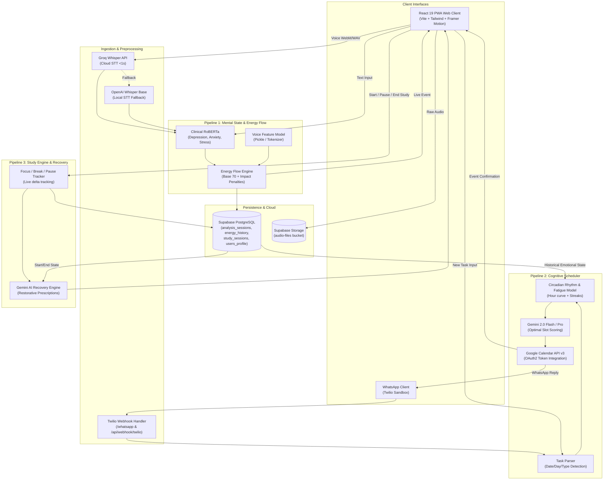
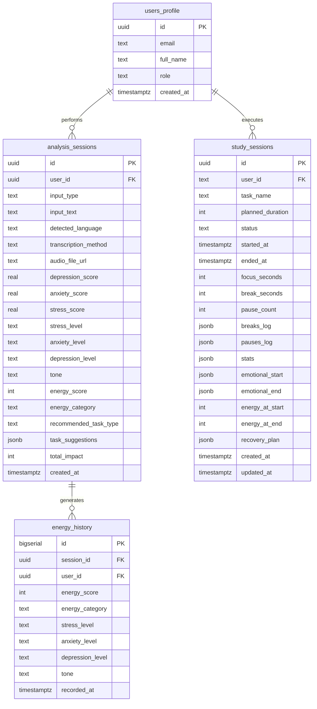

# 🧠 NeuroPilot (Let Go 3.0 / NeuroMind) — Product Requirements Document (PRD)

---

## 1. Executive Summary & Vision

### 1.1 Product Overview
**NeuroPilot** (also known as **NeuroMind** / **Let Go 3.0**) is an intelligent, multimodal cognitive performance engine and mental wellness task management platform. Traditional task management applications (e.g., Todoist, Asana, Google Calendar) operate as passive, emotion-blind schedulers that assume human energy and cognitive availability remain flat throughout the day. In contrast, NeuroPilot bridges the gap between **clinical mental health monitoring**, **circadian neuroscience**, and **autonomous task orchestration**.

NeuroPilot ingests natural language text and real-time voice inputs to evaluate psychological markers—specifically **Depression**, **Anxiety**, **Stress**, and **Emotional Tone**—using transformer-based clinical language models and speech recognition. It dynamically computes a **Real-Time Energy Score (0–100)**, accounts for circadian biological rhythms, monitors cognitive fatigue, tracks deep work sessions with Pomodoro-style cadence, and autonomously schedules tasks into **Google Calendar** during optimal cognitive windows. Furthermore, the platform features an omnichannel **WhatsApp Bot** (powered by Twilio and Google Gemini) and provides AI-generated **Personalized Recovery Plans** post-study sessions to mitigate burnout.

### 1.2 Core Objectives & Value Propositions
1. **Multimodal Emotional Sensing**: Eliminate tedious manual self-reporting by deriving mental health indicators from natural language speech and text.
2. **Dynamic Energy Flow Engine**: Translate psychological biomarkers and tone into a validated quantitative energy capacity score (0–100).
3. **Cognitive-Aware Scheduling**: Schedule high-friction (analytical/deep work) tasks during natural cognitive peaks and delegate light/recovery tasks during low-energy dips.
4. **Deep Work & Burnout Mitigation**: Track active focus time, pauses, and breaks while providing instant restorative interventions (breathwork, NSDR, physical resets) based on detected strain.
5. **Frictionless Omnichannel Interface**: Enable cross-platform task scheduling and mental health check-ins via web dashboard, PWA (offline-capable), and WhatsApp.

---

## 2. System Architecture & High-Level Flow

The platform is designed around three tightly integrated pipelines supported by an asynchronous messaging bot and a responsive frontend interface:



---

## 3. Detailed Pipeline Specifications

### 3.1 Pipeline 1: Multimodal Mental State & Energy Flow Engine

#### 3.1.1 Overview & Responsibilities
Pipeline 1 processes incoming text queries or audio recordings, transcribes voice to text if needed, evaluates mental health risk probabilities across three clinical axes (Depression, Anxiety, Stress) plus Emotional Tone, computes a mathematical Energy Score, and persists session metrics to Supabase.

#### 3.1.2 Speech-to-Text (STT) Subsystem
- **Dual-Engine Architecture**:
  1. **Primary**: Groq Whisper Cloud API (`groq_client.audio.transcriptions.create(model="whisper-large-v3")` or `whisper-base`) for ultra-low latency (<800ms) transcription.
  2. **Secondary/Fallback**: Local `openai-whisper` (`base` model loaded in RAM, approx. 1GB VRAM/RAM footprint).
- **Supported Formats**: `.webm`, `.wav`, `.mp3`, `.m4a`, `.ogg`, `.flac`.
- **Multilingual Support**: Supports 99+ languages with automatic ISO-639 language code detection (e.g., English, Hindi, Marathi, Spanish, French, German). Non-English prompts automatically engage Groq fallback language processing.
- **Audio Archival**: Audio payloads are uploaded asynchronously to Supabase Storage bucket `audio-files/uploads/<uuid>.<ext>` and assigned public signed URLs.

#### 3.1.3 Clinical NLP Classification Engine
- **Model**: Hugging Face remote repository `GehrmanSparrow1711/clinical_roberta`.
- **Architecture**: `AutoModelForSequenceClassification` with fine-tuned transformer weights and tokenizer.
- **Outputs**:
  - `Depression`: Probability score $[0.0, 1.0]$
  - `Anxiety`: Probability score $[0.0, 1.0]$
  - `Stress`: Probability score $[0.0, 1.0]$
- **Acoustic Voice Model**: `backend/models/voice_analysis.py` containing serialized `model.pkl` and `tokenizer.pkl` artifacts for extracting prosody, pitch, and acoustic stress vectors.

#### 3.1.4 Quantitative Level Classification
Probabilistic outputs are categorized into discrete severity levels:
- **High**: Probability $\ge 0.65$
- **Medium**: $0.35 \le \text{Probability} < 0.65$
- **Low / Minimal**: Probability $< 0.35$
- **Emotional Tone**: Classified as `positive`, `neutral`, or `negative`.

#### 3.1.5 Energy Flow Mathematical Model
The Energy Flow engine computes a discrete score between 0 and 100:

$$\text{Energy Score} = \text{Clamp}_{[0, 100]}\left( \text{Base} + I_{\text{stress}} + I_{\text{anxiety}} + I_{\text{depression}} + I_{\text{tone}} \right)$$

Where:
- $\text{Base} = 70$ (Standard baseline human operational energy)
- **Impact Weights ($I$)**:
  - **Stress Impact ($I_{\text{stress}}$)**:
    - High: $-20$
    - Medium: $-10$
    - Low: $0$
  - **Anxiety Impact ($I_{\text{anxiety}}$)**:
    - High: $-15$
    - Medium: $-8$
    - Low: $0$
  - **Depression Impact ($I_{\text{depression}}$)**:
    - High: $-25$
    - Medium: $-12$
    - Low: $0$
  - **Tone Impact ($I_{\text{tone}}$)**:
    - Positive: $+10$
    - Neutral: $0$
    - Negative: $-5$

#### 3.1.6 Energy Category & Task Recommendations
| Energy Score | Category | Recommended Task Type | Description & Prescribed Actions |
| :--- | :--- | :--- | :--- |
| **70 – 100** | `high_energy` | **Heavy** | Optimal cognitive state. Execute high-friction analytical tasks, deep architecture, mathematics, or intense creative synthesis. |
| **40 – 69** | `medium_energy` | **Medium** | Stable focus. Best for code reviews, refactoring, meetings, drafting documentation, and routine operational workflows. |
| **0 – 39** | `low_energy` | **Light** | Cognitive depletion / high anxiety. Avoid analytical overload. Focus on rest, passive reading, hydration, light stretching, or micro-tasks. |

---

### 3.2 Pipeline 2: Cognitive-Aware Smart Task Scheduler & Google Calendar

#### 3.2.1 Overview & Responsibilities
Pipeline 2 acts as an autonomous executive assistant. It translates natural language statements (e.g., *"Finish graph theory homework tomorrow morning"*, *"Gym on Friday evening"*) into structured cognitive objects, maps them against current psychological capacity and circadian energy curves, selects the optimal Google Calendar slot, and structures the task using cognitive work blocks.

#### 3.2.2 NLP Task Parser & Cognitive Categorization
Tasks are analyzed for temporal directives, cognitive intensity, and domains:
- **Temporal Parsing**: Detects explicit days (Monday through Sunday with automatic week-ahead delta calculation), relative days (`today`, `tomorrow`, `next week`), and duration indicators (e.g., `2 hours` $\rightarrow 120\text{ min}$; default $45\text{ min}$).
- **Cognitive Types & Category Assignment**:
  - **Analytical** (Keywords: *math, calculus, algorithm, code, programming, physics, chemistry*): Difficulty: $8/10$, Category: `Deep Work`, Preferred Window: `Morning`.
  - **Creative** (Keywords: *write, essay, design, draw, create, art, compose*): Difficulty: $6/10$, Category: `Deep Work`, Preferred Window: `Afternoon`.
  - **Memorization** (Keywords: *memorize, learn, vocabulary, flashcard, remember*): Difficulty: $5/10$, Category: `Medium Focus`, Preferred Window: `Flexible`.
  - **Physical Activity** (Keywords: *gym, workout, run, exercise, cricket, yoga*): Difficulty: $3/10$, Category: `Physical Activity`, Preferred Window: `Morning/Evening`.
  - **Social Events** (Keywords: *wedding, party, meeting, dinner, ceremony*): Difficulty: $2/10$, Category: `Social Event`, Preferred Window: `Flexible` (Default: $120\text{ min}$).
  - **Problem-Solving / General**: Difficulty: $5/10$, Category: `Medium Focus`, Preferred Window: `Flexible`.

#### 3.2.3 Circadian Rhythm & Mental Bandwidth Formulation
Mental bandwidth is evaluated on a scale of $1$ to $10$:
- **Base Circadian Energy ($B_{\text{hour}}$)**:
  - 06:00 – 09:00: $9$ (Cortisol awakening peak)
  - 10:00 – 12:00: $8$ (High executive functioning)
  - 13:00 – 14:00: $5$ (Postprandial circadian dip)
  - 15:00 – 17:00: $7$ (Secondary afternoon focus peak)
  - 18:00 – 20:00: $5$ (Twilight wind-down)
  - 21:00 – 23:00: $3$ (Pre-sleep melatonergic phase)
  - 00:00 – 05:00: $1$ (Biological rest requirement)
- **Fatigue Penalty**: $P_{\text{fatigue}} = \min(0.5 \times \text{fatigue\_counter}, 4)$
- **Break Penalty**: $P_{\text{break}} = 2$ if time since last break $> 90\text{ minutes}$, else $0$
- **Weekend Bonus**: $+1$ if Saturday or Sunday
- **Pipeline 1 Emotional Bridge Penalty**:
  $$P_{\text{emotional}} = \min(2.5 \times \text{DepressionScore} + 1.5 \times \text{AnxietyScore} + 1.0 \times \text{StressScore}, 5)$$
- **Calculated Mental Bandwidth**:
  $$\text{Energy Level} = \max\left(1, \text{round}\left(B_{\text{hour}} - P_{\text{fatigue}} - P_{\text{break}} - P_{\text{emotional}} + \text{WeekendBonus}\right)\right)$$

#### 3.2.4 Cognitive Slot Scoring Algorithm
When selecting free slots from Google Calendar, each prospective slot $S$ is evaluated:
$$\text{Score}(S) = W_e \cdot E(S) + W_p \cdot P(S) - W_f \cdot F - W_c \cdot C(S)$$
Where:
- $E(S)$ is the predicted circadian energy at slot time.
- $P(S)$ is the affinity score between the task's preferred window and candidate time.
- $F$ is the user's current accumulated fatigue.
- $C(S)$ is the scheduling conflict / proximity penalty to adjacent heavy cognitive blocks.

#### 3.2.5 Deep Work Structuring (Cognitive Block Generator)
For tasks exceeding $50$ minutes, the scheduler subdivides the event into Pomodoro-style cognitive units:
- **Deep Work Block**: Up to $50$ minutes of high-focus output.
- **Micro Break**: $10$ minutes of cognitive recovery between blocks.
- **Total Calendar Allocation**: Task Duration $+ \left(\lfloor \frac{\text{Blocks}}{2} \rfloor \times 10\right)$ minutes.

#### 3.2.6 Google Calendar v3 Synchronization
- Authenticates using stored OAuth 2.0 refresh tokens (`token.json`, `client_secret.json`) with scope `https://www.googleapis.com/auth/calendar.events`.
- Injects rich event details:
  - **Summary**: `[Emoji] Task Name` (e.g., `🧠 [Deep Work] Algorithm Design`)
  - **Description**: Contains Cognitive Type, Calculated Difficulty Rating ($1\text{--}10$), Energy State at scheduling, Break reminders, and Gamification badges.
  - **Event Color Encoding**: Deep Work: Graphite/Bold Red (`11`), Medium Focus: Yellow (`5`), Light Task: Green (`10`), Creative: Blue/Grape (`9`).

#### 3.2.7 Gamification & Cognitive State Persistence
All state metrics persist in `cognitive_state.json`:
- **Fatigue Counter**: Increases by task difficulty upon completion; decays during verified breaks.
- **Current Focus Streak**: Tracks consecutive task completions.
- **Total Deep Work Minutes**: Cumulative focus duration.
- **Milestone Achievements**:
  - `🎯 First 10 Tasks`: Awarded upon 10 total completions.
  - `🔥 5-Task Streak`: Awarded upon 5 continuous completions without abandonment.
  - `⏰ 5 Hours Deep Work`: Awarded upon reaching 300 verified focus minutes.

---

### 3.3 Pipeline 3: Study Session Monitoring & Adaptive Recovery Engine

#### 3.3.1 Overview & Responsibilities
Pipeline 3 powers **Deep Work Mode** (`/deep-work`) and the **Recovery Cycles** page (`/recovery`). It monitors active focus sessions in real time, records focus-to-break ratios, logs pause frequency, captures emotional baseline shifts (start vs. end), and queries Google Gemini 2.0 to formulate personalized recovery prescriptions.

#### 3.3.2 Session Lifecycle State Machine
```
[ IDLE ] ──(start_session)──► [ ACTIVE ] ◄──(resume_session)──► [ PAUSED ]
                                  │
                             (start_break)
                                  ▼
                              [ BREAK ] ──(end_break)──► [ ACTIVE ]
                                  │
                             (end_session)
                                  ▼
                            [ COMPLETED ] ──► (AI Recovery Engine)
```

#### 3.3.3 Telemetry & Tracking
1. **Focus Time ($T_{\text{focus}}$)**: Exact monotonic seconds elapsed during active status.
2. **Break Time ($T_{\text{break}}$)**: Cumulative seconds elapsed across all break periods.
   - Break modalities: `micro` ($2\text{ min}$), `short` ($5\text{ min}$), `long` ($15\text{ min}$), `custom`.
3. **Pause Counter ($N_{\text{pause}}$)**: Incremented on interruptions; each pause record logs start timestamp, resume timestamp, and interruption duration.
4. **Focus Efficiency Ratio**:
   $$\text{Focus Efficiency} = \left(\frac{T_{\text{focus}}}{T_{\text{focus}} + T_{\text{break}} + T_{\text{pause}}}\right) \times 100\%$$

#### 3.3.4 Adaptive AI Recovery Engine
When a session concludes, the backend sends a structured context prompt to Google Gemini:
- **Input Context**: Task name, focus duration, break counts, pause frequency, starting emotional profile, ending emotional profile, and delta in energy score.
- **Output Schema (Strict JSON)**:
  - `recovery_score`: $0\text{--}100$ (Indicates physiological/cognitive strain).
  - `urgency`: Categorized as `low`, `medium`, `high`, or `critical`.
  - `summary`: One-sentence diagnostic assessment.
  - `activities`: Array of up to 4 personalized activities containing `name`, `duration_minutes`, `impact`, `category` (`breathing`, `physical`, `mental`, `social`, `creative`), and `description`.
  - `next_session_advice`: Guidance on optimal rest interval before resuming deep work.
  - `emotional_insight`: Clinical observation linking emotional state to performance.

---

### 3.4 Feature 4: Omnichannel WhatsApp Companion Bot

#### 3.4.1 Overview
The WhatsApp Bot enables users to manage tasks, query their energy state, and receive notifications directly from mobile messaging without opening the web application.

#### 3.4.2 Twilio Webhook Architecture
- **Webhook Endpoint**: `POST /whatsapp` and `POST /api/webhook/twilio` (Accepts `application/x-www-form-urlencoded` from Twilio) and `POST /api/webhook/message` (Accepts JSON from arbitrary bot frameworks).
- **Inbound Parameters**: `Body` (message content), `From` (user's WhatsApp number, e.g. `whatsapp:+919021935820`).
- **Processing Logic**:
  1. Detects command intent (e.g., `Schedule ...`, `Add ...`, `Show stats`, `Energy level`).
  2. For scheduling intents: calls `parse_natural_language_task` $\rightarrow$ evaluates mental energy $\rightarrow$ searches Google Calendar $\rightarrow$ commits calendar event.
  3. Formulates a response formatted with WhatsApp markdown and unicode emojis.
  4. Returns standard **TwiML** `<Response><Message>...</Message></Response>` or sends proactive responses via Twilio REST Client.

---

## 4. Frontend & User Interface Architecture

The frontend is built using **React 19**, **Vite 7**, **Tailwind CSS 4**, and **Framer Motion 12**, augmented with **Three.js** / **OGL** for neural visual shaders.

```
frontend/src/
├── api.js                           # API Client connecting to FastAPI backend
├── supabaseClient.js                # Supabase Auth & Realtime client + Mock fallback
├── App.jsx                          # Main routing, layout shell, & custom event listeners
├── main.jsx                         # Application root mount
├── index.css                        # Global styling & Tailwind v4 rules
│
├── pages/
│   ├── LandingPage.jsx              # Hero 3D brain, feature breakdown, pricing
│   ├── Login.jsx                    # Supabase Email/Password authentication
│   ├── Signup.jsx                   # User registration
│   ├── DeepWorkMode.jsx             # Dedicated fullscreen Pomodoro & recovery timer
│   ├── CognitiveInsights.jsx        # Data visualization for focus, energy, and burnout
│   ├── RecoveryCycles.jsx           # AI recovery plans, session logs, & strain radar
│   └── Settings.jsx                 # User profile, thresholds, and circadian settings
│
├── components/
│   ├── Sidebar.jsx                  # Glassmorphic primary navigation
│   ├── EnergyGauge.jsx              # SVG radial arc gauge showing real-time energy (0-100)
│   ├── MetricCard.jsx               # Display card for Stress, Anxiety, Depression, Tone
│   ├── ChatInput.jsx                # Natural language text bar with voice trigger
│   ├── VoiceButton.jsx              # MediaRecorder audio capture with live audio wave
│   ├── SmartCalendar.jsx            # Interactive task list & Google Calendar viewer
│   ├── ReasoningPanel.jsx           # AI reasoning, impact weight breakdown, suggestions
│   ├── NeuralBackground.jsx         # Canvas particle neural graph with dynamic synapses
│   ├── NeuralBrain.jsx              # 3D interactive brain model
│   ├── DeepWorkToggle.jsx           # Quick launcher for focus sessions
│   ├── PWAInstallPrompt.jsx         # Browser PWA installation banner
│   └── AILanding/                   # Landing page components (BrainScrollEngine, etc.)
```

### 4.1 Page-by-Page Specifications

#### 4.1.1 Landing Page (`/`)
- **3D Brain Scroll Engine**: WebGL/Canvas shader that rotates and illuminates neural nodes as the user scrolls down the landing page.
- **Value Sections**: Multimodal sensing overview, cognitive scheduler capabilities, and Deep Work recovery engine preview.
- **Product Tiers & Monetization Model**:
  - *NeuroMind Core* (Free during Beta): Stress & anxiety monitoring, cognitive scheduler, Deep Work mode, and web dashboard.
  - *NeuroMind WhatsApp AI* (Premium): Real-time WhatsApp conversational assistant, calendar synchronization, and proactive check-ins.
  - *NeuroMind Team / Enterprise*: Parent/mentor cognitive oversight, institutional burnout analytics, and team rhythm alignment.

#### 4.1.2 Authentication (`/login`, `/signup`)
- Authenticates against **Supabase Auth** (`supabase.auth.signInWithPassword`, `supabase.auth.signUp`).
- Automatically creates and synchronizes a profile in `public.users_profile` with fields: `id`, `email`, `full_name`, `role` (`student` or `parent`).
- Includes a graceful fallback: if Supabase credentials are missing, the client automatically boots into **Demo Mode** to prevent blank screen crashes.

#### 4.1.3 Main Dashboard (`/dashboard`)
- **Header & Profile Bar**: Displays personalized greeting based on local time, role badge, live sync status pill, and user profile initials.
- **Energy Gauge**: Dynamic SVG circular gauge representing current energy score ($0\text{--}100$) with color interpolation:
  - Green / Emerald: $70\text{--}100$ (High Energy)
  - Amber / Yellow: $40\text{--}69$ (Medium Energy)
  - Red / Rose: $0\text{--}39$ (Low Energy)
- **Clinical Biomarker Metric Cards**:
  - **Stress**: Displays level (`Low`, `Medium`, `High`) and raw decimal probability.
  - **Anxiety**: Displays level (`Stable`, `Moderate`, `High`) and raw score.
  - **Depression**: Displays level (`None`, `Mild`, `Elevated`) and risk metric.
  - **Emotional Tone**: Displays sentiment (`Positive`, `Neutral`, `Negative`).
- **Reasoning Panel**: Collapsible panel detailing the breakdown of Clinical RoBERTa predictions, impact weight adjustments, and actionable clinical advice.
- **Smart Calendar Section**: Displays weekly/daily schedules, cognitive tags (`Analytical`, `Creative`, `Social`), difficulty badges ($1\text{--}10$), and an interactive **Add Task** bar connected to `/api/scheduler/schedule`.
- **Multimodal Chat & Audio Input**: Bottom docking bar with textarea input and interactive microphone button.

#### 4.1.4 Deep Work Mode (`/deep-work`)
- **Distraction-Free Fullscreen View**: Dark obsidian backdrop with subtle neural synapse animations.
- **Focus Controls**: Start, Pause, Resume, and Conclude Session.
- **Preset & Custom Duration**: $25\text{ min}$, $50\text{ min}$, $90\text{ min}$, or user-defined duration.
- **Break Management**: Modal to initiate `Short Break (5m)`, `Long Break (15m)`, `Micro Break (2m)`, or custom intervals.
- **Focus Ambience**: Integrated focus audio toggle and "Shield Mode" toggle (simulating notification muting).
- **Live State Persistence**: Synchronizes session status, elapsed seconds, and pause counters to backend every status transition.
- **Post-Session Modal**: Automatically surfaces AI Recovery Plan upon session conclusion.

#### 4.1.5 Cognitive Insights (`/insights`)
- **Burnout Risk Index**: Dynamic gauge computed from focus hours, depression score, and stress level:
  $$\text{Burnout Index} = \min(100, \text{round}(12 \times \text{FocusHours} + 30 \times \text{DepressionScore} + 25 \times \text{StressScore}))$$
- **Recharts Visualizations**:
  - *Daily Focus Hours*: Area chart plotting productivity against weekly average.
  - *Cognitive Fatigue Curve*: Line chart depicting circadian dips vs. actual session output.
  - *Task Distribution*: Donut chart categorizing time spent across Deep Work, Medium Focus, and Recovery.

#### 4.1.6 Recovery Cycles (`/recovery`)
- **Recovery Need Radial Meter**: Visualizes immediate recovery deficit percentage.
- **Historical Recovery Cards**: Displays completed focus blocks with starting vs. ending emotional state.
- **Actionable AI Activities**: Step-by-step guides for suggested recovery exercises (e.g., *Box Breathing (4-4-4-4)*, *Non-Sleep Deep Rest (NSDR)*, *20-20-20 Visual Rest*, *Hydration & Electrolyte replenishment*).

#### 4.1.7 Settings (`/settings`)
- Dark Theme & UI contrast preferences.
- Push notification threshold controls (e.g., notify when burnout risk exceeds $65\%$).
- Daily baseline focus targets and circadian working hours configuration.
- Google Calendar account status and disconnection controls.

---

## 5. Comprehensive API Specification

The backend is built with **FastAPI** (`backend/main.py`), running on port `8000`.

### 5.1 Pipeline 1 Endpoints (Mental State & Energy)

#### 1. Text Pipeline (`POST /api/analyze/text`)
- **Request Body**:
  ```json
  {
    "text": "I feel completely overwhelmed with my algorithm exam tomorrow and can barely focus.",
    "user_id": "optional-uuid"
  }
  ```
- **Response (`200 OK`)**:
  ```json
  {
    "status": "success",
    "session_id": "a4d3390f-0744-486d-929e-21ef29bb0849",
    "input_text": "I feel completely overwhelmed with my algorithm exam tomorrow and can barely focus.",
    "analysis": {
      "Depression": 0.38,
      "Anxiety": 0.84,
      "Stress": 0.91,
      "source": "local_model"
    },
    "energy_flow": {
      "raw_probabilities": {
        "depression": 0.38,
        "anxiety": 0.84,
        "stress": 0.91
      },
      "classified_levels": {
        "stress": "high",
        "anxiety": "high",
        "depression": "medium",
        "tone": "negative"
      },
      "energy_score": 23,
      "energy_category": "low_energy",
      "recommended_task_type": "light",
      "task_description": "You have low energy. Focus on rest, light activities, and self-care.",
      "task_suggestions": [
        "Take breaks and rest",
        "Do light stretching or breathing exercises",
        "Engage in relaxing activities"
      ],
      "impact_breakdown": {
        "stress_impact": -20,
        "anxiety_impact": -15,
        "depression_impact": -12,
        "tone_impact": -5,
        "total_impact": -52
      },
      "base_energy": 70
    },
    "persisted": true
  }
  ```

#### 2. Voice Pipeline (`POST /api/analyze/voice`)
- **Request Content-Type**: `multipart/form-data`
- **Form Parameters**:
  - `audio`: Binary audio file (`.webm`, `.wav`, `.mp3`)
  - `user_id`: Optional string UUID
- **Response (`200 OK`)**:
  ```json
  {
    "status": "success",
    "session_id": "c1f729e1-2f3b-4874-9842-16ad9bc1936b",
    "transcription": {
      "text": "I feel very tired and anxious today.",
      "language": "en",
      "method": "groq_whisper"
    },
    "analysis": {
      "Depression": 0.32,
      "Anxiety": 0.74,
      "Stress": 0.61,
      "source": "local_model"
    },
    "energy_flow": { ... },
    "audio_info": {
      "filename": "audio.webm",
      "storage_url": "https://xyz.supabase.co/storage/v1/object/public/audio-files/uploads/file.webm"
    },
    "persisted": true
  }
  ```

#### 3. Session History Query (`GET /api/sessions`)
- **Query Parameters**: `limit` (default: 20), `user_id` (optional)
- **Response**: List of previous `analysis_sessions` rows ordered by `created_at DESC`.

#### 4. Energy History Query (`GET /api/energy-history`)
- **Query Parameters**: `limit` (default: 50), `user_id` (optional)
- **Response**: Array of historical energy score points for trend line charts.

#### 5. Daily Energy Averages (`GET /api/energy-daily`)
- **Response**: Grouped daily average scores with count of sessions per day.

---

### 5.2 Pipeline 2 Endpoints (Cognitive Scheduler)

#### 1. Parse Task (`POST /api/scheduler/parse-task`)
- **Request Body**: `{"task": "Prepare calculus presentation for Thursday"}`
- **Response**: Returns parsed cognitive type, difficulty, duration, preferred time, and target date.

#### 2. Schedule Task (`POST /api/scheduler/schedule`)
- **Request Body**: `{"task": "Deep work on algorithm optimization for 2 hours tomorrow"}`
- **Response**:
  ```json
  {
    "status": "success",
    "task": {
      "task_name": "Deep work on algorithm optimization for 2 hours tomorrow",
      "difficulty": 8,
      "duration_minutes": 120,
      "category": "Deep Work",
      "cognitive_type": "Analytical"
    },
    "work_structure": {
      "blocks": [
        { "start": "2026-10-28T09:00:00+05:30", "end": "2026-10-28T09:50:00+05:30", "type": "deep_work", "duration": 50 },
        { "start": "2026-10-28T09:50:00+05:30", "end": "2026-10-28T10:00:00+05:30", "type": "micro_break", "duration": 10 },
        { "start": "2026-10-28T10:00:00+05:30", "end": "2026-10-28T10:50:00+05:30", "type": "deep_work", "duration": 50 },
        { "start": "2026-10-28T10:50:00+05:30", "end": "2026-10-28T11:00:00+05:30", "type": "micro_break", "duration": 10 },
        { "start": "2026-10-28T11:00:00+05:30", "end": "2026-10-28T11:20:00+05:30", "type": "deep_work", "duration": 20 }
      ],
      "total_time": 140
    },
    "calendar_event": {
      "event_id": "cal_abc123456",
      "html_link": "https://www.google.com/calendar/event?eid=...",
      "start_time": "2026-10-28T09:00:00+05:30"
    }
  }
  ```

#### 3. Complete Task (`POST /api/scheduler/complete-task`)
- **Request Body**: `{"task_name": "Deep work on algorithm optimization", "actual_difficulty": 8}`
- **Response**: Increments streak, logs deep work minutes, updates fatigue, and returns any new unlocked achievements.

#### 4. Cognitive Statistics (`GET /api/scheduler/stats`)
- **Response**:
  ```json
  {
    "fatigue": 8,
    "streak": 4,
    "total_deep_work": 280,
    "tasks_completed": 9,
    "total_all_time": 15,
    "achievements": ["5-Task Streak"],
    "recent_tasks": [...]
  }
  ```

#### 5. Scheduler Mental Energy (`GET /api/scheduler/energy`)
- **Response**: Returns real-time circadian energy score ($1\text{--}10$), penalties, and situational advice.

---

### 5.3 Pipeline 3 Endpoints (Study Sessions)

| Endpoint | Method | Payload / Params | Description |
| :--- | :--- | :--- | :--- |
| `/api/study/start` | `POST` | `{"user_id": str, "task_name": str, "duration_minutes": int}` | Starts new focus session; logs emotional state snapshot at start. |
| `/api/study/current/{user_id}` | `GET` | `user_id` (path) | Retrieves current active/paused/break study session for user. |
| `/api/study/pause` | `POST` | `{"session_id": str}` | Pauses study session; increments pause count; tracks focus time delta. |
| `/api/study/resume` | `POST` | `{"session_id": str}` | Resumes study session from pause; calculates pause duration. |
| `/api/study/break` | `POST` | `{"session_id": str, "break_type": str, "custom_duration_seconds": int}` | Initiates break period (`short`, `long`, `micro`, `custom`). |
| `/api/study/end-break` | `POST` | `{"session_id": str}` | Concludes break and resumes active focus tracking. |
| `/api/study/end` | `POST` | `{"session_id": str}` | Ends study session; computes stats; generates Gemini AI recovery plan. |
| `/api/study/session/{session_id}` | `GET` | `session_id` (path) | Retrieves real-time session stats (live computed focus seconds). |
| `/api/study/stats/today/{user_id}` | `GET` | `user_id` (path) | Returns total focus seconds, break seconds, pause count for today. |
| `/api/study/stats/weekly/{user_id}` | `GET` | `user_id` (path) | Returns daily breakdown of focus minutes, breaks, and session count over 7 days. |
| `/api/study/recovery-plan/{user_id}`| `GET` | `user_id` (path) | Generates recovery plan on demand based on recent history. |

---

### 5.4 Webhook Endpoints (WhatsApp / Twilio)

#### 1. Twilio Webhook (`POST /api/webhook/twilio`)
- **Content-Type**: `application/x-www-form-urlencoded`
- **Payload**: Standard Twilio payload containing `Body` and `From`.
- **Response (`200 OK`)**: XML/TwiML response with formatted markdown for WhatsApp.

#### 2. Generic Message Webhook (`POST /api/webhook/message`)
- **Content-Type**: `application/json`
- **Payload**: `{"message": str, "user_id": str, "phone_number": str}`
- **Response**: JSON payload with parsed task details, calendar confirmation, and response message.

---

## 6. Database Schema & Data Models (Supabase PostgreSQL)

### 6.1 Entity-Relationship Overview



### 6.2 Table Definitions

#### 1. `analysis_sessions`
Primary repository for every text or voice interaction analyzed through Pipeline 1.
- `id`: `UUID` PRIMARY KEY DEFAULT `gen_random_uuid()`
- `user_id`: `TEXT` (links to `auth.users.id` / `users_profile.id`)
- `input_type`: `TEXT NOT NULL CHECK (input_type IN ('text', 'voice'))`
- `input_text`: `TEXT`
- `detected_language`: `TEXT` (e.g. `'en'`, `'hi'`, `'mr'`)
- `transcription_method`: `TEXT` (`'groq_whisper'` or `'local_whisper'`)
- `audio_file_url`: `TEXT` (Supabase Storage URL)
- `depression_score`, `anxiety_score`, `stress_score`: `REAL` ($0.0\text{--}1.0$)
- `analysis_source`: `TEXT` (`'local_model'`, `'groq_fallback_language'`)
- `stress_level`, `anxiety_level`, `depression_level`: `TEXT` (`'high'`, `'medium'`, `'low'`)
- `tone`: `TEXT` (`'positive'`, `'neutral'`, `'negative'`)
- `base_energy`: `INTEGER DEFAULT 70`
- `energy_score`: `INTEGER` ($0\text{--}100$)
- `energy_category`: `TEXT` (`'high_energy'`, `'medium_energy'`, `'low_energy'`)
- `recommended_task_type`: `TEXT` (`'heavy'`, `'medium'`, `'light'`)
- `task_description`: `TEXT`
- `task_suggestions`: `JSONB`
- `stress_impact`, `anxiety_impact`, `depression_impact`, `tone_impact`, `total_impact`: `INTEGER`
- `created_at`, `updated_at`: `TIMESTAMPTZ DEFAULT NOW()`

#### 2. `energy_history`
Granular time-series table utilized for plotting historical graphs and longitudinal trends.
- `id`: `BIGSERIAL` PRIMARY KEY
- `session_id`: `UUID REFERENCES analysis_sessions(id) ON DELETE CASCADE`
- `user_id`: `TEXT`
- `energy_score`: `INTEGER NOT NULL`
- `energy_category`: `TEXT`
- `stress_level`, `anxiety_level`, `depression_level`, `tone`: `TEXT`
- `recorded_at`: `TIMESTAMPTZ DEFAULT NOW()`

#### 3. `study_sessions`
Engine telemetry table tracking Deep Work sessions and AI Recovery plans.
- `id`: `UUID` PRIMARY KEY DEFAULT `gen_random_uuid()`
- `user_id`: `TEXT NOT NULL`
- `task_name`: `TEXT DEFAULT 'Focus Session'`
- `planned_duration`: `INTEGER DEFAULT 90`
- `status`: `TEXT DEFAULT 'active' CHECK (status IN ('active', 'paused', 'break', 'completed', 'abandoned'))`
- `started_at`: `TIMESTAMPTZ DEFAULT NOW()`
- `ended_at`: `TIMESTAMPTZ`
- `focus_seconds`: `INTEGER DEFAULT 0`
- `break_seconds`: `INTEGER DEFAULT 0`
- `pause_count`: `INTEGER DEFAULT 0`
- `breaks_log`: `JSONB DEFAULT '[]'` (Stores individual break start/end/type/duration)
- `pauses_log`: `JSONB DEFAULT '[]'` (Stores pause timestamps)
- `stats`: `JSONB` (Stores aggregated metrics: focus percentage, average block, energy change)
- `emotional_start`: `JSONB` (Snapshot from latest `analysis_sessions` row at session start)
- `emotional_end`: `JSONB` (Snapshot at session end)
- `energy_at_start`, `energy_at_end`: `INTEGER`
- `recovery_plan`: `JSONB` (Generated by Gemini AI)
- `created_at`, `updated_at`: `TIMESTAMPTZ DEFAULT NOW()`

#### 4. `users_profile`
Application user metadata mirrored from Supabase Auth.
- `id`: `UUID` PRIMARY KEY
- `email`: `TEXT NOT NULL`
- `full_name`: `TEXT`
- `role`: `TEXT DEFAULT 'student' CHECK (role IN ('student', 'parent', 'mentor'))`
- `created_at`: `TIMESTAMPTZ DEFAULT NOW()`

#### 5. Storage Buckets
- `audio-files`: Public read storage bucket for uploaded voice audio.

---

## 7. Security, Privacy & Reliability

### 7.1 Data Protection & Clinical Privacy
- **Mental Health Data Confidentiality**: Clinical biomarker probability scores (Depression, Anxiety, Stress) represent sensitive personal data. In production environments, Row Level Security (RLS) restricts read/write operations strictly to `auth.uid() = user_id`.
- **Audio Disposal & Retention**: Audio files in the `audio-files` bucket are hashed with UUID identifiers without PII in filenames.
- **Client Fallback (Zero-Downtime Guarantee)**:
  - If backend ML services or Supabase are temporarily unreachable, the frontend dynamically switches into **Demo Mode** or utilizes local heuristic fallbacks, ensuring user interfaces never freeze or present blank screens.

### 7.2 Service Worker & PWA Reliability
- **PWA Manifest**: Configured in `frontend/public/manifest.json` with multi-size icons, theme color `#0a0e1a`, and standalone display mode.
- **Service Worker (`sw.js`)**:
  - Implements **Network-First** strategy for all `/api/` endpoints with graceful JSON fallback payloads when offline.
  - Implements **Cache-First** strategy for static build bundles, SVGs, audio clips, and stylesheet assets.
  - Safe URL parsing and response cloning prevent unhandled cache rejection errors.

---

## 8. Deployment, Infrastructure & DevOps

### 8.1 Technology Stack Summary
- **Backend**: Python 3.10+, FastAPI, Uvicorn, PyTorch, Transformers, Hugging Face Hub, OpenAI Whisper, Groq SDK, Google GenAI SDK, Google API Python Client, PyTZ, Supabase-py.
- **Frontend**: Node.js 20+, React 19, Vite 7, Tailwind CSS 4, Framer Motion 12, Recharts, Three.js, Lucide React.
- **Database & Auth**: Supabase (PostgreSQL, Supabase Auth, Supabase Storage, Realtime Engine).
- **External APIs**: Groq Cloud API, Google Calendar API v3, Twilio WhatsApp API, Google Gemini 2.0 API.

### 8.2 Environment Configuration Variables

#### Backend (`backend/.env`)
```ini
SUPABASE_URL="https://cjdfadtrbddoclodxtjh.supabase.co"
SUPABASE_KEY="eyJhbGciOiJIUzI1NiIsInR5cCI6IkpXVCJ9..."
GROQ_API_KEY="gsk_..."
GEMINI_API_KEY="AIzaSy..."
PORT=8000
```

#### Frontend (`frontend/.env`)
```ini
VITE_API_URL="http://127.0.0.1:8000"
VITE_SUPABASE_URL="https://cjdfadtrbddoclodxtjh.supabase.co"
VITE_SUPABASE_ANON_KEY="eyJhbGciOiJIUzI1NiIsInR5cCI6IkpXVCJ9..."
```

### 8.3 Deployment Targets
1. **Frontend**: Configured for instant deployment on **Vercel** (`vercel.json` with SPA route rewrites) or **Netlify** (`netlify.toml`).
2. **Backend**: Configured for containerized deployment on **Render** (`backend/render.yaml` and `Dockerfile`) or Railway/AWS ECS.
3. **Local Development Startup**:
   - Windows unified script: `run.bat` (Handles UTF-8 terminal encoding `chcp 65001`, launches backend and frontend in parallel windows).
   - Cross-platform npm runner: `npm run dev` (Uses `concurrently` and `cross-env`).

---

## 9. Verification & Automated Testing Matrix

The repository contains an end-to-end automated verification script (`test_all_features.py`) testing all system layers:

1. **Environment Integrity Check**: Verifies existence and formatting of `SUPABASE_URL`, `SUPABASE_KEY`, `GROQ_API_KEY`, and `VITE_API_URL`.
2. **Backend Health & Model Metadata**: Pings `/api/health` and `/api/model-info` to ensure `clinical_roberta` and `whisper` are loaded in memory.
3. **Pipeline 1 Verification**:
   - Dispatches sample text query to `/api/analyze/text` and asserts presence of `analysis`, `energy_flow`, and Supabase `session_id`.
   - Sends simulated multipart audio to `/api/analyze/voice` and checks transcription accuracy and storage URL creation.
4. **Pipeline 2 Verification**:
   - Calls `/api/scheduler/parse-task` with test task.
   - Pings `/api/scheduler/energy` to verify circadian calculation.
   - Pings `/api/scheduler/stats` to verify gamification counters.
5. **Pipeline 3 Verification**:
   - Initiates test study session at `/api/study/start`.
   - Executes pause/resume cycles and triggers break periods.
   - Concludes session at `/api/study/end` and checks Gemini AI recovery plan payload structure.
6. **Frontend Availability**: Asserts HTTP 200 on `http://localhost:5174`.

---

## 10. Future Roadmap & Product Evolution

1. **Phase 1: Biometric Hardware Synchronization (Wearables)**
   - Integrate Apple HealthKit, Whoop, and Oura Ring Webhooks to ingest real-time Heart Rate Variability (HRV), resting heart rate, and sleep architecture scores directly into the Energy Flow formula.
2. **Phase 2: Voice Acoustic Fine-Tuning**
   - Implement real-time client-side WebAssembly audio feature extraction (jitter, shimmer, fundamental pitch variation) to evaluate vocal affect before sending audio upstream.
3. **Phase 3: Multi-User Collaboration & Team Energy Synchronizer**
   - Enable teams and classrooms to visualize aggregate cognitive load heatmaps, preventing managers/teachers from scheduling intense meetings during team-wide circadian dips.
4. **Phase 4: Proactive WhatsApp Interventions**
   - Enable autonomous cron routines where the bot proactively messages the user on WhatsApp when study sessions run excessively long without breaks: *"Hey Neelay, you've been in deep focus for 95 minutes with 4 pauses. Your predicted energy is dipping. Step away for 10 minutes!"*
