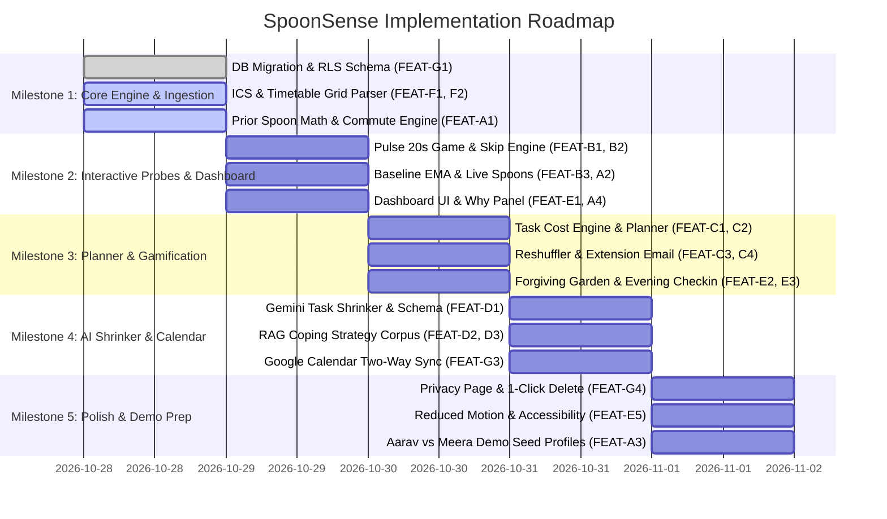

# SpoonSense — Master Feature Breakdown & Allocation List (`feature_list.md`)

> **Document Status**: Production / Hackathon MVP Task Allocation Matrix  
> **Source Document**: [`Final_PRD.md`](file:///home/neelay/Desktop/Vjti/Final_PRD.md) (v2.0 Full Specification)  
> **System Name**: **SpoonSense** — A Load-Aware Planner that Forecasts Energy Budgets, Checks with 20-Second Games, and Shrinks Tasks without Shame.  
> **Primary Philosophy**: *Sensing without questionnaires, planning without shame, shrinking without judgment.*

---

## 1. Quick Allocation Summary (Workstream Overview)

Use this table to assign whole tracks or individual tickets to team members.

| Workstream | Focus Area | Primary Tech Stack | Priority Scope | Target Role / Assignee |
| :--- | :--- | :--- | :--- | :--- |
| **Track A** | **Context Load & Spoon Engine** | Python / TypeScript (Pure Math) | P0 (MVP Must-Have) | **Backend / Algorithm Lead** |
| **Track B** | **20-Second Cognitive Games** | HTML5 Canvas / Web API / React | P0 (Pulse) + P1 (Switch, Pop) | **Frontend / Interactive Dev** |
| **Track C** | **Capacity Planner & Reshuffler** | TypeScript / Python | P0 (Planner) + P1 (Reshuffle, Mail) | **Full-Stack Logic Dev** |
| **Track D** | **AI Micro-Sequencer & RAG** | Google Gemini 2.0 / RAG / JSON Schema | P0 (Shrink) + P1 (RAG, Fallback) | **AI / LLM Engineer** |
| **Track E** | **Frontend PWA & Zero-Shame UI** | React 19 / Tailwind 4 / Framer Motion | P0 (Dashboard, Why Panel, Garden) | **Frontend / UI/UX Lead** |
| **Track F** | **Timetable & Commute Ingestion** | iCal.js / Gemini Vision / React | P0 (ICS, Commute) + P1 (OCR) | **Full-Stack Ingestion Dev** |
| **Track G** | **Backend, DB & Data Privacy** | FastAPI / Supabase PostgreSQL / RLS | P0 (Auth, CRUD, RLS) + P1 (Export) | **Backend / DevOps Engineer** |

---

## 2. Priority Definition
- **P0 (Must-Have for Demo / MVP)**: Non-negotiable core functionality required for end-to-end user loop.
- **P1 (High Priority / Post-Core)**: Core differentiators that elevate judging scores (Empathy & Usability).
- **P2 (Optional / Bonus / Tier 2)**: Stretch goals, demo toggles, or post-hackathon roadmap items.

---

## 3. Workstream A: Context Load & Spoon Engine (Pure Core Logic)

**Owner Role**: *Algorithm & Core Engine Developer*  
**Objective**: Build the transparent, additive mathematical engine that turns daily schedule, commute, deadlines, and carryover into actionable "Spoons" (1 to 12 energy units) with a full breakdown explanation.

---

### [FEAT-A1] Prior Spoon Calculation Engine
- **PRD Reference**: Section 11.4 `FR-SP-01`, Section 12.2–12.6
- **Priority**: **P0**
- **Input Parameters**:
  - `budget`: Default 12 spoons
  - `commute_minutes`: Round-trip duration in minutes
  - `commute_mode`: `crowded` (1.0), `seated` (0.6), `walk` (0.3)
  - `campus_hours`: First class start to last class end
  - `tasks`: Upcoming task list with due dates
  - `previous_day_spend`: Total spoons spent yesterday
  - `previous_evening_label`: Optional 0–4 score from yesterday
- **Mathematical Specification**:
  ```python
  commute_cost = (total_commute_minutes / 30.0) * 0.5 * mode_factor
  campus_cost = campus_hours * 0.5
  
  # Deadline pressure (capped at 2.0 spoons)
  deadline_pressure = 0.0
  for task in upcoming_tasks_next_3_days:
      urgency = 1.0 if task.due_today else (0.6 if task.due_tomorrow else 0.3)
      deadline_pressure += min(task.cost, 2.0) * urgency * 0.25
  deadline_pressure = min(deadline_pressure, 2.0)
  
  # Carryover exhaustion (capped at lower bound 0)
  carryover = max(0.0, 0.4 * (previous_day_spend - 6.0))
  if previous_evening_label is not None:
      # Low evening label (0-1) adds +0.5 carryover, high (3-4) subtracts 0.5
      carryover += (2 - previous_evening_label) * 0.25
  carryover = max(0.0, carryover)
  
  prior_spoons = budget - commute_cost - campus_cost - deadline_pressure - carryover
  ```
- **Acceptance Criteria**:
  - Unit tests match Worked Example in Section 12.12: Aarav Monday (240m crowded commute = 4.0, 9h campus = 4.5 $\rightarrow$ Prior = 3.5 spoons).
  - Pure function with zero DOM or network dependencies.
  - Returns a detailed dictionary of each factor's exact delta for the "Why Panel".

---

### [FEAT-A2] Live Spoon Calculation & Multiplier Calibration
- **PRD Reference**: Section 11.4 `FR-SP-02`, `FR-SP-03`, Section 12.7–12.9
- **Priority**: **P0**
- **Specification**:
  ```python
  # Probe multiplier from game result
  # RT <= baseline * 1.20 -> 1.0
  # RT between 1.20 and 1.35 baseline -> 0.85 (or linear interpolation)
  # RT >= 1.35 baseline -> 0.70
  # RT faster than baseline (RT < 0.85) -> 1.0 (no speed reward)
  
  live_spoons = clamp(prior_spoons * probe_multiplier * tier2_adjust, 1.0, 12.0)
  ```
- **Acceptance Criteria**:
  - If no game was played, `probe_multiplier = 1.0`.
  - Values are strictly clamped between `1.0` and `12.0`. Value can never be $\le 0$.
  - Soft range calculation: `confidence = 0.4 + 0.04 * min(days, 15) + (0.1 if game_played else 0)`. Range = `live_spoons ± (1.5 * (1 - confidence))`.

---

### [FEAT-A3] 7-Day Energy Weather Forecaster
- **PRD Reference**: Section 11.4 `FR-SP-06`, Section 16.3
- **Priority**: **P0**
- **Specification**:
  - Runs prior calculation across each of the upcoming 7 days based on scheduled timetable, known commute overrides, and task deadlines.
  - Maps forecasted spoons to weather icons:
    - $\ge 8.0$ spoons: ☀️ **Sunny** (Expansive Capacity)
    - $5.0 - 7.9$ spoons: ⛅ **Partly Cloudy** (Balanced Steady Work)
    - $3.0 - 4.9$ spoons: 🌧️ **Rainy** (Low Energy / Heavy Commute)
    - $< 3.0$ spoons: ⛈️ **Stormy** (High Overload / Rest First Mode)
- **Acceptance Criteria**:
  - Weather strip endpoint / function returns an array of 7 objects with date, expected spoons, range, weather icon, and primary driving factor.

---

### [FEAT-A4] "Why Panel" Factor Decomposition Generator
- **PRD Reference**: Section 11.4 `FR-SP-05`
- **Priority**: **P0**
- **Specification**:
  - Every calculation outputs an explainable breakdown list:
    - Base Capacity: `+12.0 spoons`
    - Commute Impact (120m crowded): `-2.0 spoons`
    - Campus Time (6 hours): `-3.0 spoons`
    - Deadline Strain (DBMS Project): `-0.8 spoons`
    - Yesterday Carryover: `-0.7 spoons`
    - Morning Game Adjustment: `×0.85`
    - **Final Estimated Spoons**: `4.7 spoons` (Range: 4.0 – 5.5)
- **Acceptance Criteria**:
  - Sum of breakdown factors strictly equals the displayed live number.
  - Text uses empathetic, non-judgmental phrasing (no clinical or blaming terminology).

---

## 4. Workstream B: 20-Second Cognitive Games & Probes

**Owner Role**: *Frontend / Web Audio / Canvas Developer*  
**Objective**: Build lightweight, 20-to-30-second browser games that evaluate personal attention, reaction latency, and flexibility against a rolling baseline without grades, pressure, or red error states.

---

### [FEAT-B1] "Pulse" Attention & Reaction Game (20 Seconds)
- **PRD Reference**: Section 11.5 `FR-GM-01`, Section 13.2
- **Priority**: **P0**
- **Mechanics**:
  - Screen displays a calm, breathing circular glyph.
  - At pseudo-random intervals between $1500\text{ms}$ and $4000\text{ms}$, the circle changes shade/luminance.
  - User taps anywhere on the screen or hits spacebar immediately upon noticing.
  - Conducts 6 to 8 trials in exactly 20 seconds.
- **Telemetry & Guardrails**:
  - Anticipation filter: Taps $< 100\text{ms}$ are discarded as accidental/anticipatory.
  - Lapse threshold: No tap within $1000\text{ms}$ counted as a lapse.
  - Computes `median_rt` and `rt_variability` (Median Absolute Deviation).
  - Invalidates if tab visibility changes (`document.hidden`) or valid trials $< 4$.
- **Acceptance Criteria**:
  - Runs butter-smooth at 60fps on mobile browsers using `requestAnimationFrame` and `performance.now()`.
  - Zero red screens or "Failed" alerts. Ends with: *"Thanks. That helps me plan."*

---

### [FEAT-B2] Game Skip & Zero-Penalty Bailout
- **PRD Reference**: Section 11.5 `FR-GM-04`
- **Priority**: **P0**
- **Specification**:
  - Prominent button on every game screen: *"Skip, just use my schedule"*.
  - Immediately closes the game modal, sets `probe_multiplier = 1.0`, logs `{ skipped: true }`, and displays no negative confirmation or score reduction.
- **Acceptance Criteria**:
  - User can bypass game in 1 tap without any guilt message.

---

### [FEAT-B3] Exponential Moving Average (EMA) Personal Baseline Engine
- **PRD Reference**: Section 11.5 `FR-GM-05`, Section 12.9
- **Priority**: **P0**
- **Specification**:
  ```typescript
  // Local storage baseline tracker
  baseline_new = alpha * today_median_rt + (1 - alpha) * baseline_prev
  // alpha = 0.25
  ```
- **Rules**:
  - First 3 plays are strictly calibration trials (`is_calibrating = true`, multiplier locked at `1.0`). UI says *"Still learning your usual"*.
  - Stored locally in `localStorage` / `IndexedDB` per device identifier (device-switch flags trigger recalibration).
- **Acceptance Criteria**:
  - Raw trial arrays are kept only in memory during game execution and cleared immediately.
  - Only aggregate summary (`median_rt`, `lapses`, `variability`) is stored.

---

### [FEAT-B4] "Switch" Cognitive Flexibility Game (30 Seconds)
- **PRD Reference**: Section 11.5 `FR-GM-02`, Section 13.3
- **Priority**: **P1**
- **Mechanics**:
  - Colored shapes appear one by one.
  - Phase 1: Sort by Color (Left vs. Right).
  - Gentle visual cue switches rule: Sort by Shape (Left vs. Right).
  - Measures `switch_cost` (RT on first 2 trials after rule change minus baseline trials) and `perseveration_count`.
- **Acceptance Criteria**:
  - Erroneous sorts never flash red or play negative buzzer sounds.
  - Feeds into secondary multiplier clamp (nudges by max $\pm 5\%$).

---

### [FEAT-B5] "Pop Garden" Always-Winning Off-Ramp Game
- **PRD Reference**: Section 11.5 `FR-GM-03`, Section 13.4
- **Priority**: **P1**
- **Mechanics**:
  - Soothing floating bubbles rise slowly. Tapping pops them and waters a tiny seedling.
  - Zero timer pressure; impossible to lose.
  - Used as an off-ramp when live spoons are $< 3.0$ or when user needs low-friction engagement.
- **Acceptance Criteria**:
  - Works fully with touch or mouse; accessible with screen readers and reduced motion.

---

## 5. Workstream C: Capacity-Sized Planner & Task Cost Engine

**Owner Role**: *Full-Stack / Core Planner Developer*  
**Objective**: Allocate tasks into days and time slots strictly within forecasted spoon capacity, preserve breathing room, automatically reshuffle overcommitted work, and generate polite extension email drafts when hard deadlines cannot fit.

---

### [FEAT-C1] Task Cost Estimation Engine
- **PRD Reference**: Section 11.3 `FR-TK-02`, Section 14.1–14.2
- **Priority**: **P0**
- **Formulation**:
  ```python
  cost = minutes * rate[type] * difficulty_multiplier
  # Rates:
  # reading: 0.067 spoons/min (15 min ≈ 1 spoon)
  # writing: 0.09 spoons/min
  # problem_solving: 0.089 spoons/min (45 min ≈ 4 spoons)
  # admin: 0.05 spoons/min
  # micro_step: 0.10 spoons/min (2 min = 0.2 spoons)
  # difficulty: easy = 0.8, normal = 1.0, hard = 1.2
  ```
- **Acceptance Criteria**:
  - Adding a task with only a title auto-assigns default duration based on type (reading: 20m, writing: 30m, problem-solving: 45m, admin: 10m).
  - Every task displays its calculated spoon cost badge (e.g., `🥄 2.5`).
  - User can manually edit/override the cost badge at any time.

---

### [FEAT-C2] Capacity-Sized Day Planning Algorithm
- **PRD Reference**: Section 11.8 `FR-PL-01`, `FR-PL-02`, Section 14.3
- **Priority**: **P0**
- **Rules**:
  1. Calculate available budget: $\text{Planned Capacity} = \text{Live Spoons} \times (1 - \text{Reserve})$, where default reserve is $20\%$ ("Breathing Room").
  2. Order pending tasks by earliest hard deadline, then by cost descending.
  3. Greedily fit tasks into the earliest day with sufficient remaining capacity.
  4. Never schedule tasks to exceed $80\%$ of a day's live capacity.
  5. Schedule heavy deep-work blocks during peak energy hours (morning outside commute windows).
- **Acceptance Criteria**:
  - Produces an hourly/daily plan with total planned spoons, reserved spoons, and a one-line human explanation (e.g., *"Light mode today because of 4 hours commute and a slower morning check-in."*).

---

### [FEAT-C3] Automatic Low-Capacity Reshuffler
- **PRD Reference**: Section 11.8 `FR-PL-03`, Section 14.5–14.6
- **Priority**: **P1**
- **Trigger**:
  - Live spoons drop below planned load by $\ge 20\%$ (e.g., tough commute or low game result).
- **Behavior**:
  - Moves highest-cost, least-urgent flexible tasks to the nearest future day with forecast $> 6$ spoons.
  - Never automatically moves a task across a fixed external deadline.
  - Displays calm toast notification: *"Moved Friday's lab draft to Saturday, which looks lighter."* with a 1-tap **Undo** button.
- **Acceptance Criteria**:
  - Reshuffling is completely non-punitive; no warning dialogs, no red badges.
  - If a task has been reshuffled $\ge 3$ times, triggers an empathetic offer: *"This task has been moved a few times. Want to shrink it into a 2-minute step?"*

---

### [FEAT-C4] Polite Extension-Email Generator
- **PRD Reference**: Section 11.8 `FR-PL-04`, Section 14.7
- **Priority**: **P1**
- **Trigger**:
  - A hard fixed deadline cannot fit within capacity before the due date.
- **Specification**:
  - Calls Gemini or local template to generate a professional, polite extension request.
  - Fields: Course Name, Assignment Title, Proposed New Date, Professor/TA Name.
  - **Ethical Guardrail**: Never mentions medical claims, mental health diagnoses, or trauma dumping. Strictly frames the request around academic workload and quality.
  - Renders inside an editable modal with a **"Copy to Clipboard"** or **"Open in Mail"** button. Never automatically sends an email.
- **Acceptance Criteria**:
  - Output is cleanly formatted, concise, polite, and fully user-editable.

---

### [FEAT-C5] Rest as a First-Class Schedule Item
- **PRD Reference**: Section 11.8 `FR-PL-06`, Section 14.8
- **Priority**: **P1**
- **Specification**:
  - Users can insert "Rest Blocks" (e.g., 20m power nap, walk, listening to music).
  - Rest blocks credit spoons back: $+0.5\text{ spoons}$ for $20\text{ minutes}$.
  - Taking and completing rest blocks increments the Garden water count: *"Rest is a W"*.
- **Acceptance Criteria**:
  - Rest blocks sit alongside academic tasks in the calendar with soothing green/lavender aesthetics.

---

## 6. Workstream D: AI Micro-Sequencer & Coping RAG Engine

**Owner Role**: *AI / LLM & RAG Engineer*  
**Objective**: Build the anti-paralysis rescue tool that shrinks overwhelming tasks into a sub-2-minute physically concrete first step, powered by Google Gemini and a curated coping strategy corpus.

---

### [FEAT-D1] Task Shrinker (LLM Micro-Sequencer Endpoint)
- **PRD Reference**: Section 11.9 `FR-MS-01`, `FR-MS-02`, Section 15.1–15.3
- **Priority**: **P0**
- **API**: `POST /api/sequence`
- **Request Schema**:
  ```json
  {
    "task": { "title": "Write 10-page literature review", "type": "writing" },
    "liveSpoons": 3.2,
    "userNote": "I feel stuck and don't know where to start"
  }
  ```
- **Strict JSON Output Schema**:
  ```json
  {
    "steps": [
      {
        "position": 1,
        "text": "Open Google Docs and write the assignment title at the top.",
        "minutes": 2,
        "spoon_cost": 0.2,
        "why": "Starting is the hardest part. Just opening the document breaks paralysis."
      },
      {
        "position": 2,
        "text": "Paste in 2 paper titles you've already found.",
        "minutes": 5,
        "spoon_cost": 0.5,
        "why": "Low friction progress."
      }
    ]
  }
  ```
- **Hard Constraints**:
  - Step 1 duration must be $\le 2\text{ minutes}$ and physically actionable (e.g., "open folder", "write name").
  - System prompt bans words: *should, must, behind, late, fail, lazy*.
- **Acceptance Criteria**:
  - Returns within 4 seconds. Step 1 is displayed as the primary focus; remaining steps are collapsed.

---

### [FEAT-D2] Curated Coping Strategy RAG Corpus (30–60 Passages)
- **PRD Reference**: Section 11.9 `FR-MS-03`, Section 15.4–15.5
- **Priority**: **P1**
- **Corpus Details**:
  - Curated markdown/JSON snippets covering: *Two-Minute Rule, Implementation Intentions ("If-Then"), Body Doubling, Task Chunking, Lowest-Hanging Fruit, Sensory Friction Reduction, Gentle Self-Talk*.
  - Categorized with metadata: `task_type`, `effort_level`, `situation`.
- **Retrieval Mechanism**:
  - Lightweight cosine similarity using embedding or keyword-vector ranking (pgvector or in-memory array for MVP).
  - Retrieves top 3 snippets and passes them to Gemini as grounding context.
- **Acceptance Criteria**:
  - Every micro-step includes an empathetic "Why this works" line grounded in the retrieved strategy.

---

### [FEAT-D3] "Smaller Please" Sub-Divider
- **PRD Reference**: Section 11.9 `FR-MS-05`, Section 15.10
- **Priority**: **P1**
- **Specification**:
  - If a 2-minute step still causes friction, user clicks **"Smaller please"**.
  - Halves the step complexity down to atomic sensory actions (e.g., *"Just sit in your study chair for 60 seconds without opening the laptop"*).
  - Tapping complete on any sub-step awards immediate micro-win XP.
- **Acceptance Criteria**:
  - Works up to 3 recursions without failing or repeating.

---

### [FEAT-D4] Offline Rule-Based Sequencer Fallback
- **PRD Reference**: Section 11.9 `FR-MS-04`, Section 15.8
- **Priority**: **P0**
- **Specification**:
  - If network is offline or Gemini API key is missing/rate-limited, falls back to a deterministic local template engine:
    - `writing`: ["Open the document file", "Type your name and today's date", "Write one bullet point summary"]
    - `coding`: ["Open your code editor", "Create a new branch or open the test file", "Read line 1 of the spec"]
    - `reading`: ["Open the PDF to page 1", "Read only the section headings and abstract", "Highlight 1 sentence"]
- **Acceptance Criteria**:
  - 100% test pass rate in disconnected / offline mode.

---

### [FEAT-D5] Ethical Guardrails & Crisis Redirection
- **PRD Reference**: Section 11.9 `FR-MS-04`, Section 15.7, Section 20.2
- **Priority**: **P0**
- **Specification**:
  - Adversarial diagnostic checks (e.g., *"Do I have ADHD?"*, *"Am I clinically depressed?"*) return a warm, non-diagnostic response redirecting to campus counselors without labels.
  - Distress/Self-harm detection immediately renders a compassionate card with verified student helpline numbers (Vandrevala Foundation, AASRA, Tele-MANAS) and halts task sequencing.
- **Acceptance Criteria**:
  - Guardrail unit tests pass for 10 adversarial probe prompts.

---

## 7. Workstream E: Frontend PWA & Zero-Shame UI/UX

**Owner Role**: *Frontend / UI / Design Systems Engineer*  
**Objective**: Build a clean, glassmorphic, gentle user interface with forgiving gamification, no red overdue markers, no broken streaks, full dark mode, and complete accessibility.

---

### [FEAT-E1] SpoonSense Main Dashboard & Capacity Meter
- **PRD Reference**: Section 11.4 `FR-SP-05`, Section 21
- **Priority**: **P0**
- **Components**:
  - **Spoon Capacity Meter**: Visual representation of 12 spoons (filled, active, reserved, spent).
  - **Why Button**: Tap spoon count to open bottom sheet factor breakdown.
  - **Energy Weather Bar**: 7-day horizontal preview with icons and expected capacity.
  - **Today's Focus List**: Tasks filtered to current day, showing spoon badges.
  - **Quick Action Bar**: "Add Task", "Check-in (Game)", "Shrink a Task".
- **Design Language**:
  - Palette: Calming slate/navy `#0a0e1a`, soft lavender `#8B5CF6`, sage green `#10B981`, gentle sky blue `#38BDF8`.
  - Zero high-saturation alert reds (`#EF4444` replaced with warm amber `#F59E0B` for notices).

---

### [FEAT-E2] The Forgiving Garden (Streak That Never Wilts)
- **PRD Reference**: Section 11.11 `FR-GA-01`, Section 16.1
- **Priority**: **P0**
- **Specification**:
  - An interactive SVG plant that grows with daily logins, micro-step completions, or resting.
  - **Anti-Shame Rules**:
    - The plant **never dies or wilts**.
    - If user misses 3 days or 3 weeks, status is "Frozen in gentle hibernation".
    - Returning user sees: *"Welcome back, we saved your spot in the garden."*
    - Streak is labeled as **"Days Tended"**, never "Current Streak".
- **Acceptance Criteria**:
  - Zero guilt-inducing notifications or broken streak counters.

---

### [FEAT-E3] One-Tap Evening Check-in
- **PRD Reference**: Section 11.7 `FR-EV-01`–`FR-EV-04`
- **Priority**: **P0**
- **Specification**:
  - Triggered at user's preferred time (default: 8:00 PM).
  - 5 calm icons (Battery levels or calm face expressions: 0 to 4 spoons remaining).
  - One tap saves the result, waters the garden, and closes immediately.
  - Optional unpressured 1-line text note: *"Anything that drained you today?"* (Stored locally).
  - Visible **"Skip"** button with zero penalty.
- **Acceptance Criteria**:
  - Takes $< 10\text{ seconds}$ to complete.

---

### [FEAT-E4] Dopamine Menu (Off-Ramp Rest Drawer)
- **PRD Reference**: Section 11.11 `FR-GA-04`, Section 16.4
- **Priority**: **P1**
- **Specification**:
  - User-curated list of low-friction enjoyable micro-activities:
    - *Starter items*: "5-minute walk outside", "Make a cup of chai", "Listen to 1 favorite song", "Light stretch", "Water a plant".
  - Suggested when live spoons drop below $3.0$.
  - Engaging in any dopamine item awards $+0.2$ to $+0.5$ spoons and garden XP.
- **Acceptance Criteria**:
  - Drawer can be customized, edited, and opened on demand.

---

### [FEAT-E5] Accessibility, Reduced Motion & Dark Mode
- **PRD Reference**: Section 11.12 `FR-ST-04`, `FR-ST-05`, Section 21.6
- **Priority**: **P0**
- **Specification**:
  - Toggle in settings for **Reduced Motion**: Disables all spring physics, particle effects, and pulse animations.
  - High contrast ratio ($\ge 4.5:1$) on all text elements.
  - Large tap targets ($\ge 48\text{px}$) for mobile usability during fatigue.
  - Keyboard navigation support (`Tab`, `Space`, `Enter`, `Escape`) across all games and modals.
- **Acceptance Criteria**:
  - Passes Lighthouse accessibility audit $\ge 95$.

---

## 8. Workstream F: Timetable & Commute Ingestion

**Owner Role**: *Data Ingestion & Integration Developer*  
**Objective**: Enable students to import their complex recurring college timetables and commute details in under 3 minutes with minimal manual typing.

---

### [FEAT-F1] ICS / iCal Timetable File Parser
- **PRD Reference**: Section 11.2 `FR-TT-01`, Section 26.1
- **Priority**: **P0**
- **Specification**:
  - Client-side or backend parsing of `.ics` calendar files using `ical.js` / `icalendar`.
  - Extracts recurring weekly events: Start Time, End Time, Weekday (0–6), Course Title.
  - Displays parsed schedule in a confirmation preview before saving to database.
- **Acceptance Criteria**:
  - Successfully parses a standard university ICS export containing 20+ classes without dropping weekday recurring rules.

---

### [FEAT-F2] Fast Weekly Visual Grid Builder
- **PRD Reference**: Section 11.2 `FR-TT-02`
- **Priority**: **P0**
- **Specification**:
  - Interactive grid representing Monday–Saturday, 8:00 AM to 6:00 PM.
  - Tap-and-drag or click-to-toggle hourly blocks to mark class/lab times.
  - Calculates campus hours automatically from first class start to last class end.
- **Acceptance Criteria**:
  - User can manually build a full week's schedule in under 45 seconds.

---

### [FEAT-F3] Commute Profile Form & Daily Overrides
- **PRD Reference**: Section 11.2 `FR-TT-04`, `FR-TT-05`
- **Priority**: **P0**
- **Specification**:
  - Fields:
    - Round-trip commute minutes (e.g., 120m)
    - Transit mode: `crowded train/bus` (factor 1.0), `seated transit` (0.6), `walking/cycling` (0.3)
    - Applicable weekdays
  - Daily Override Drawer: Allows marking specific days as `Work From Home`, `Exam Day`, or `College Holiday` (resets campus hours to 0).
- **Acceptance Criteria**:
  - Changing commute or marking WFH immediately recalculates that day's spoon forecast.

---

### [FEAT-F4] Gemini Vision Timetable Photo Extractor
- **PRD Reference**: Section 11.2 `FR-TT-03`
- **Priority**: **P1**
- **Specification**:
  - User uploads a photo/screenshot of a printed or handwritten class schedule.
  - Endpoint `POST /api/timetable/photo` sends image to Gemini 2.0 Flash Vision.
  - Gemini extracts structured JSON array of `{ weekday, start_time, end_time, title }`.
  - Client always displays extracted items for user confirmation/edit before saving.
- **Acceptance Criteria**:
  - Extracts valid schedule from clean photo with $\ge 80\%$ accuracy; user can edit any error before saving.

---

## 9. Workstream G: Backend, Database, Auth & Privacy

**Owner Role**: *Backend / Supabase / DevOps Engineer*  
**Objective**: Provide scalable persistence, Google authentication, local-first anonymous mode, Google Calendar synchronization, and transparent data privacy controls.

---

### [FEAT-G1] Supabase Database Schema Migration
- **PRD Reference**: Section 17.2, Section 17.3
- **Priority**: **P0**
- **Tables to Create / Update**:
  1. `users_profile` (`id`, `email`, `full_name`, `settings`, `baseline_summary`, `anonymous`)
  2. `timetable_blocks` (`id`, `user_id`, `weekday`, `start_time`, `end_time`, `title`, `source`)
  3. `commute_profiles` (`id`, `user_id`, `minutes_each_way`, `mode`, `days_applicable`)
  4. `day_overrides` (`id`, `user_id`, `date`, `type`, `value`)
  5. `tasks` (`id`, `user_id`, `title`, `type`, `due_date`, `is_fixed_deadline`, `estimated_minutes`, `spoon_cost`, `state`, `planned_date`)
  6. `task_steps` (`id`, `task_id`, `position`, `text`, `minutes`, `spoon_cost`, `why_text`, `state`)
  7. `day_snapshots` (`id`, `user_id`, `date`, `prior_spoons`, `live_spoons`, `factors`, `confidence`, `weather`)
  8. `game_results` (`id`, `user_id`, `date`, `game`, `summary`, `valid`, `skipped`)
  9. `evening_labels` (`id`, `user_id`, `date`, `value`, `skipped`)
  10. `garden_state` (`user_id`, `days_tended`, `xp`, `items`, `last_checkin_date`)
- **Row Level Security (RLS)**:
  - Strict RLS policies ensuring users can only read/write their own records (`auth.uid() = user_id`).
- **Acceptance Criteria**:
  - Idempotent migration script runs without errors in Supabase SQL editor.

---

### [FEAT-G2] Google Sign-in & Zero-Friction Anonymous Mode
- **PRD Reference**: Section 11.1 `FR-AO-01`, `FR-AO-03`
- **Priority**: **P0**
- **Specification**:
  - Google OAuth sign-in via Supabase Auth.
  - **Anonymous Mode**: User can bypass login entirely and use the app using local `IndexedDB` / `localStorage`.
  - All features work in anonymous mode except external Google Calendar sync.
- **Acceptance Criteria**:
  - Switching between anonymous and authenticated mode offers to merge local data.

---

### [FEAT-G3] Google Calendar Synchronization
- **PRD Reference**: Section 11.10 `FR-CL-01`–`FR-CL-04`
- **Priority**: **P1**
- **Specification**:
  - OAuth 2.0 connection with scope `https://www.googleapis.com/auth/calendar.events`.
  - Writes capacity-sized planned focus blocks into user's Google Calendar tagged `[SpoonSense]`.
  - Read-only calendar toggle available in settings.
  - When tasks are reshuffled, updates existing calendar events rather than duplicating them.
  - **1-Tap Disconnect**: Button in settings instantly removes all SpoonSense events and revokes tokens.
- **Acceptance Criteria**:
  - Event modifications are clean with zero orphaned duplicate blocks.

---

### [FEAT-G4] Data Privacy, Export & One-Click Delete
- **PRD Reference**: Section 11.12 `FR-ST-01`–`FR-ST-03`, Section 20
- **Priority**: **P0**
- **Specification**:
  - **Privacy Page (`/privacy`)**: Plain-language breakdown of what stays on device, what is stored on cloud, and what is never collected (no clinical diagnosis, no institution access, no screen/keystroke tracking).
  - **Export Data (`POST /api/me/export`)**: Generates and downloads a complete `.json` file containing user's timetable, tasks, game summaries, and snapshots.
  - **One-Click Delete (`DELETE /api/me`)**: Purges all server records from Supabase within 1 transaction and clears browser storage.
- **Acceptance Criteria**:
  - Export and delete functions work seamlessly and verifiable by hackathon judges.

---

## 10. Sprint Milestones & Hackathon Execution Roadmap

Refer to Section 26 of `Final_PRD.md` for sequencing:



---

## 11. Hackathon Demo Script Alignment Checklist

To ensure maximum score on the judging rubric (**30% Empathy, 30% Intervention Friction, 20% Ethical Tracking, 20% Usability**), verify these exact demo moments:

- [ ] **Contrast Demonstration (30s)**: Load **Aarav** (4hr commute $\rightarrow 2.4$ spoons, Stormy weather) vs. **Meera** (short walk $\rightarrow 7.4$ spoons, Sunny weather) side-by-side using the exact same timetable.
- [ ] **Zero-Shame Probe (20s)**: Play the 20-second **Pulse** game. Demonstrate clicking **Skip** with zero penalty, no broken streak, and no guilt messaging.
- [ ] **Autonomous Reshuffle (25s)**: Show Aarav's heavy lab draft automatically moving to a lighter day with an editable, polite extension email draft ready to copy.
- [ ] **Anti-Paralysis Shrink (25s)**: Take a daunting 10-page research paper and click **"Shrink it"** $\rightarrow$ transforms into *"Open Google Docs and write your name"*.
- [ ] **Ethical Verification (15s)**: Open the **Why Panel** and **Privacy Page**, demonstrating 100% visible math, zero clinical diagnoses, and 1-click data deletion.
